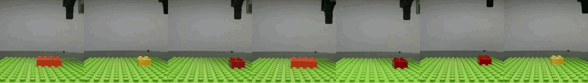

<h1 align="center">
  
</h1>

<h3 align="center">
  Visuomotor Skill Composition with Situated Manual Guidance for Long-Horizon Interlocking Brick Assembly
</h3>

<p align="center">
  Jichuan Yu<sup>*</sup>, Bowei Li<sup>*</sup>, Zhenran Tang, Guanxing Lu, Chuxiong Hu, Ruixuan Liu, Changliu Liu
</p>

<p align="center">
  <sup>*</sup> Equal contribution
</p>

<p align="center">
  <strong>Accepted by IEEE Robotics and Automation Letters (RA-L)</strong>
</p>

<p align="center">
  🔗 <a href="https://intelligent-control-lab.github.io/BrickCraft/"><strong>Project Page</strong></a> | 📄 <a href="https://arxiv.org/abs/2605.07605"><strong>Paper</strong></a> | 🤗 <a href="https://huggingface.co/JerryYuu/BrickCraft"><strong>Models</strong></a> | 📊 <a href="https://huggingface.co/datasets/JerryYuu/brickcraft"><strong>Dataset</strong></a>
</p>

---

<p align="center">
  
</p>

BrickCraft is a compositional framework for long-horizon interlocking brick assembly. Given a target brick structure, it first reasons about a feasible assembly plan. Then, guided by situated manuals that provide explicit visual guidance, it composes learned visuomotor skills to assemble the target structure in the physical world.

## Installation

### Prerequisites

- **Real-robot platform:** This repository provides the code for BrickCraft's real-world experiments on a **Kinova Gen3** robot. Robot execution depends on **ROS1 Noetic** on Ubuntu 20.04 and the external [kinova_ros_control](https://github.com/intelligent-control-lab/kinova_ros_control) controller; follow its setup instructions before running the robot.
- **Environment:** Tested on Ubuntu 20.04 and Python 3.10.
- **GPU:** Perception and policy training/inference require an NVIDIA GPU with a compatible CUDA environment. Tested on an NVIDIA GeForce RTX 4090.
- **Hardware setup:** Prepare the robot, workspace and wrist cameras, assembly board, and brick supply rails following the [hardware setup guide](docs/hardware_setup.md). For teleoperation and demonstration collection, also prepare a SpaceMouse.
- **Blender (optional):** For rendering assembly-plan images and masks, download [Blender ≥ 3.0 for Linux](https://www.blender.org/download/) and extract the archive. Add the directory containing the `blender` executable to `PATH`:

  ```bash
  export PATH="/path/to/blender-directory:$PATH"
  blender --version
  ```

  Replace `/path/to/blender-directory` with your extracted Blender directory. To keep this setting in future terminals, add the `export` line to `~/.bashrc`.

### Environment Setup

**1. Clone the repository and create the environment.**

```bash
git clone https://github.com/intelligent-control-lab/BrickCraft.git
cd BrickCraft

conda create -n brickcraft python=3.10 -y
conda activate brickcraft
```

**2. Install BrickCraft.** PyTorch and the Python dependencies are installed automatically.

```bash
python -m pip install -e .
python -m pip check
```

Keep `numpy>=2.0,<2.3`; LeRobot 0.4.4's dependencies require NumPy 2.

TorchCodec requires FFmpeg 4–7 shared libraries. If not already available, install them via your system package manager or Conda:

```bash
conda install -c conda-forge "ffmpeg>=4,<8"
```

Dependencies include:

- **[LeRobot v0.4.4](https://github.com/huggingface/lerobot/tree/v0.4.4)** for datasets and policies.
- **[Ultralytics](https://github.com/ultralytics/ultralytics)** for YOLOv8-seg.
- **ImageIO with FFmpeg support** for video I/O.
- **easyhid** for SpaceMouse teleoperation.

**3. Install the [SAM-2 real-time fork](https://github.com/Gy920/segment-anything-2-real-time).** This third-party fork provides live camera tracking. Compilation requires:

- A local **CUDA Toolkit** with `nvcc`, matching the CUDA major/minor version reported by your installed PyTorch (`torch.version.cuda`). See the [NVIDIA installation guide](https://docs.nvidia.com/cuda/cuda-installation-guide-linux/) if a Toolkit installation is needed.

  ```bash
  nvcc --version
  python -c "import torch; print('PyTorch CUDA:', torch.version.cuda); print('GPU available:', torch.cuda.is_available())"
  ```

  Confirm that `nvcc` is available, the CUDA major/minor versions match, and `GPU available` is `True`.

- A compatible **C++ compiler**. On Ubuntu: `sudo apt install build-essential`.

Install SAM-2:

```bash
python -m pip install --no-build-isolation git+https://github.com/Gy920/segment-anything-2-real-time.git
```

### ROS1 Setup

Set up the robot controller and camera drivers in ROS1 Noetic following
[kinova_ros_control](https://github.com/intelligent-control-lab/kinova_ros_control). For BrickCraft:

```bash
conda activate brickcraft
python -m pip install rospkg catkin_pkg
source /opt/ros/noetic/setup.bash
python -c "import rospy; from brickcraft.robots.Kinova import KinovaPose9D"
```

Do not add `/usr/lib/python3/dist-packages` to Conda's `PYTHONPATH`, to prevent
Ubuntu 20.04's system packages from interfering with the Python environment.

### Model Checkpoints

- **Brick Diffusion policy:** Predicts end-effector pose and gripper actions for
  single-step assembly and the assembly skill in the long-horizon pipeline.
  Download the `pretrained_model` directory from
  [Hugging Face](https://huggingface.co/JerryYuu/BrickCraft/tree/main/brickcraft_diffusion)
  and place it at `./models/brickcraft_diffusion/pretrained_model/`, including
  the weights, configuration, and processors. Set the assembly controller's
  `pretrained_path` in
  [configs/single_step_config.yaml](configs/single_step_config.yaml) or
  [configs/pipeline_config.yaml](configs/pipeline_config.yaml) to that directory.
- **SAM-2:** Follow the [fork's checkpoint download instructions](https://github.com/Gy920/segment-anything-2-real-time#download-checkpoint). We use `sam2.1_hiera_tiny.pt`; copy it to `./models/` after downloading.
- **YOLOv8-seg:** Download the two checkpoints below from [Hugging Face](https://huggingface.co/JerryYuu/BrickCraft/tree/main/yolo) and place both `.pt` files in `./models/`.

  | Checkpoint | Purpose | Classes |
  | --- | --- | --- |
  | `seg_structure.pt` | Segment the assembled brick structure on the baseplate for scene alignment | `0: object` |
  | `seg_brick_gripper.pt` | Segment the gripper and the brick held by it | `0: brick`, `1: gripper` |

---

## Usage

Run all commands from the repository root with the `brickcraft` environment activated.

### 1. Generate an Assembly Plan

Ready-to-use L1–L7 plans are in [configs/assembly_plans](configs/assembly_plans).
See [L1/plan.json](configs/assembly_plans/L1/plan.json) for the plan format and
[configs/structures](configs/structures) for target structure inputs. Each bundle
contains the plan, an input copy, rendered images and masks, and a structure preview.

To generate and render a new plan with Blender:

```bash
python scripts/generate_assembly_plan.py --structure configs/structures/L1.json --render
```

Output defaults to `configs/assembly_plans/L1/`. Omit `--render` to generate only
the plan and input copy; use `--output path/to/plan.json` to change the output path.
The current single-arm planner supports `2x2` and `2x4` bricks with `ori=0`.
Input `x`/`y` use stud-grid coordinates on the 16 × 16 board; `z=1` is the first layer.

To render an existing plan:

```bash
blender -b -P scripts/render_assembly_plan.py -- --plan configs/assembly_plans/L1/plan.json
```

### 2. Train a Policy

Download the [BrickCraft dataset](https://huggingface.co/datasets/JerryYuu/brickcraft).

Log in to W&B before training (skip this if W&B logging is disabled):

```bash
wandb login
```

Use [the example training config](configs/train_config_example.json) and replace the placeholders below with your paths and W&B identifiers:

```bash
python scripts/train.py \
  --config_path=./configs/train_config_example.json \
  --output_dir="<output_dir>" \
  --dataset.root="<dataset_root>" \
  --job_name="<job_name>" \
  --wandb.enable=true \
  --wandb.project="<wandb_project>" \
  --batch_size=32 \
  --steps=80000
```

Set `--wandb.enable=false` to disable W&B logging. `--steps` is the number of training updates.

Task encodings must have six components: `[x, y, z, orientation, reference_type, target_type]`.

### 3. Run a Single Assembly Step

Set the policy checkpoint, SAM-2 checkpoint, and task encoding in
[configs/single_step_config.yaml](configs/single_step_config.yaml). The task
encoding must use the same six-component format as the policy checkpoint.

Manually prepare an existing structure on the assembly baseplate and place the
target brick in the robot's gripper.
With the robot and cameras connected, run:

```bash
python scripts/run_single_step.py --config configs/single_step_config.yaml
```

Press `s` to start an episode, `q` to stop the current episode, and `e` to exit.
Before policy execution, provide segmentation prompts interactively in SAM2 by
clicking the reference brick, target brick, and gripper.
`confirm_segmentation: true` shows the initial result for confirmation or
reselection; `false` skips this review.

### 4. Run Long-Horizon Assembly Pipeline

To run an assembly plan such as [L1/plan.json](configs/assembly_plans/L1/plan.json),
set `plan_path: ./configs/assembly_plans/L1` in
[configs/pipeline_config.yaml](configs/pipeline_config.yaml). This must point to
the directory containing `plan.json` and its rendered masks. Organize bricks by
type following the [hardware setup guide](docs/hardware_setup.md), determine
their pick poses in advance, and record them in the config.
The assembly baseplate does not require pose calibration.

Before starting, manually install the plan's `initial_brick` on the assembly baseplate
as an anchor, then run:

```bash
python scripts/run_pipeline.py --config configs/pipeline_config.yaml
```

### 5. SpaceMouse Teleoperation

On Ubuntu, install the HIDAPI shared library if it is missing:

```bash
sudo apt install libhidapi-hidraw0
```

The current user needs read/write access to the SpaceMouse's `/dev/hidraw*`
device. Configure your system's udev permissions if access is denied.

Connect the SpaceMouse and find its device path:

```bash
python -m brickcraft.teleop.list_spacemouse
```

Replace `/dev/hidraw5` with the enumerated path and start teleoperation:

```bash
python scripts/spacemouse_teleop.py --device-path /dev/hidraw5
```

To enable ROS1 rosbag recording, append `--record-rosbag` and optionally
`--rosbag-output-dir ./data/rosbags/teleop` to the command above. Recording produces
ROS1 bags; conversion to a training-ready dataset is a separate step.

| Control | Behavior |
| --- | --- |
| SpaceMouse translation and rotation | Move the end-effector pose target |
| `button[0]` | Toggle gripper: open `0.0`, close `0.8` by default |
| `button[1]` | Start/stop recording when `--record-rosbag` is enabled |
| Keyboard `q` or `Ctrl+C` | Exit and close the recorder and SpaceMouse |

See [spacemouse_teleop_common.py](src/brickcraft/teleop/spacemouse_teleop_common.py)
for control parameters and defaults.

## File Structure

```text
BrickCraft/
├── configs/
│   ├── structures/                # Target structure inputs
│   ├── assembly_plans/            # Plan JSON, input copies, rendered images and masks
│   ├── train_config_example.json  # Policy training config
│   ├── single_step_config.yaml    # Single-step testing config
│   └── pipeline_config.yaml       # Long-horizon assembly config
├── scripts/                       # Entry points for the workflows
├── src/brickcraft/
│   ├── planner/                   # Assembly plan generation
│   ├── blender/                   # Plan rendering
│   ├── policies/                  # Assembly policy and processors
│   ├── controller/                # Policy execution and robot control
│   ├── perception/                # Segmentation, alignment, and step identification
│   ├── pipeline/                  # Plan loading and long-horizon execution
│   ├── skills/                    # Pick and assembly skills
│   ├── robots/                    # Kinova robot interface and configuration
│   ├── teleop/                    # SpaceMouse control and ROS1 bag recording
│   ├── assets/                    # Runtime assets
│   └── utils/                     # Shared utilities
├── docs/                          # Hardware setup guide and public media
└── pyproject.toml                 # Package metadata and dependencies
```

---

## Citation

If you find this work useful, please consider citing:

```bibtex
@misc{yu2026brickcraft,
  title={BrickCraft: Visuomotor Skill Composition with Situated Manual Guidance for Long-Horizon Interlocking Brick Assembly},
  author={Jichuan Yu and Bowei Li and Zhenran Tang and Guanxing Lu and Chuxiong Hu and Ruixuan Liu and Changliu Liu},
  year={2026},
  eprint={2605.07605},
  archivePrefix={arXiv},
  primaryClass={cs.RO},
  url={https://arxiv.org/abs/2605.07605},
}
```
