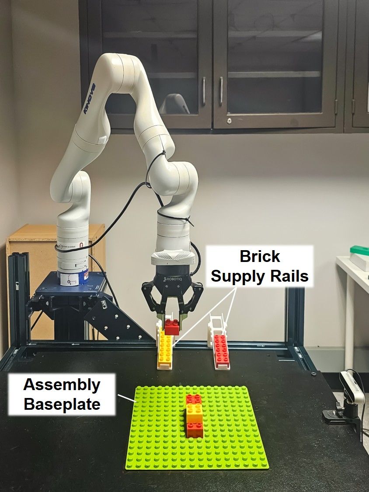
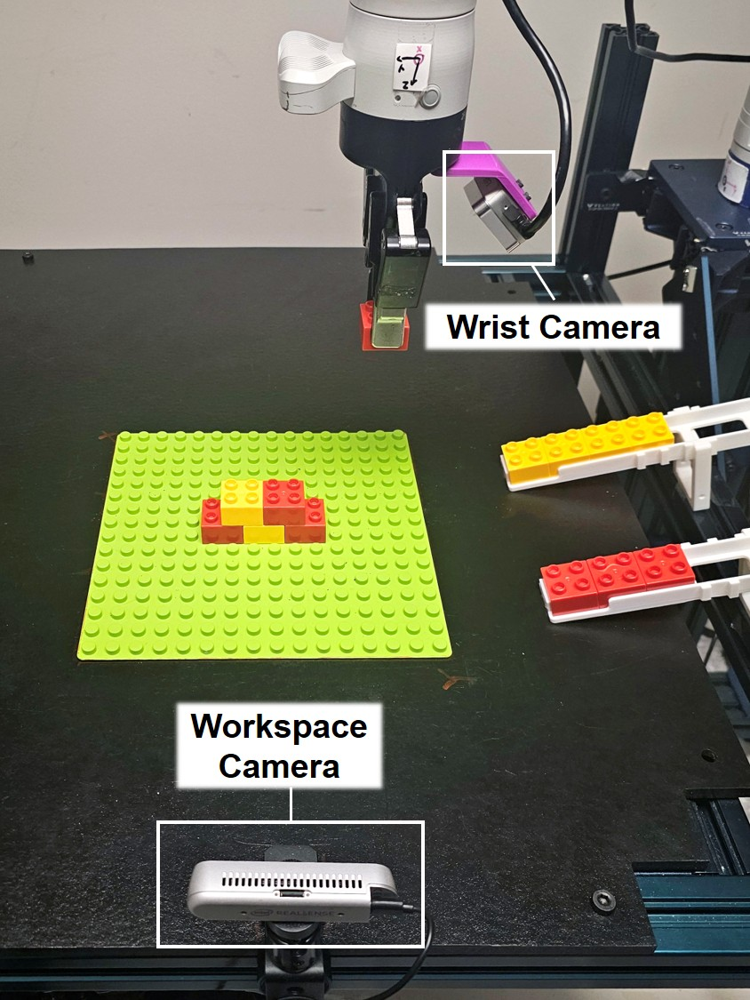

# Hardware Setup

## Workspace

The experimental workspace layout is shown below.

| Front view | Side view |
| --- | --- |
|  |  |

## Hardware and Materials

| Component | Model / Description |
| --- | --- |
| Robot arm | Kinova Gen3 |
| Gripper | Robotiq 2F-85 |
| SpaceMouse | [3Dconnexion SpaceMouse Compact](https://3dconnexion.com/us/product/spacemouse-compact/): 6-DoF input device for Kinova teleoperation and demonstration collection, with two buttons for gripper control and optional ROS1 rosbag recording. |
| Workspace camera | Intel RealSense D415 |
| Wrist camera | Intel RealSense D405 |
| Camera mount | 3D-printed wrist-camera mount ([STL](assets/stl/wrist_camera_mount_D405.STL)) |
| Brick supply rails | 3D-printed supply rails ([rail STL](assets/stl/brick_supply_rail.STL), [support STL](assets/stl/brick_supply_rail_support.STL)) |
| Baseplate and bricks | LEGO DUPLO-sized baseplate and 2x2/2x4 bricks (~19 mm brick height and 16 mm stud pitch). [Amazon](https://www.amazon.com/dp/B092D6N5MC) |
